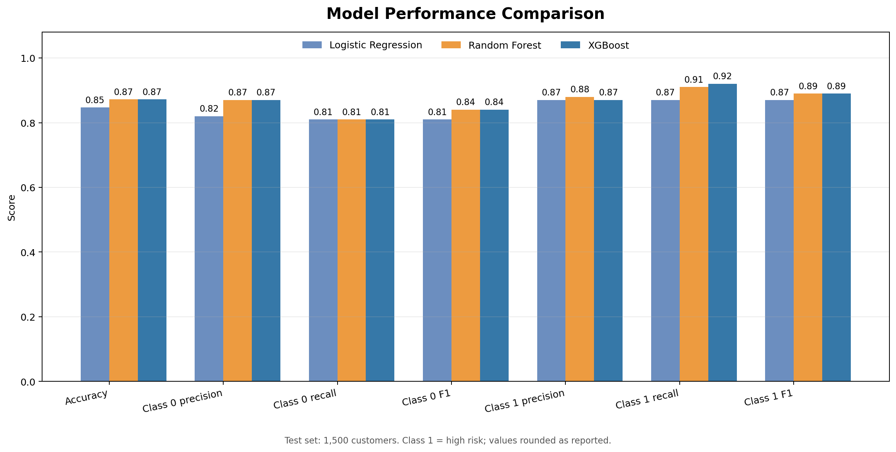
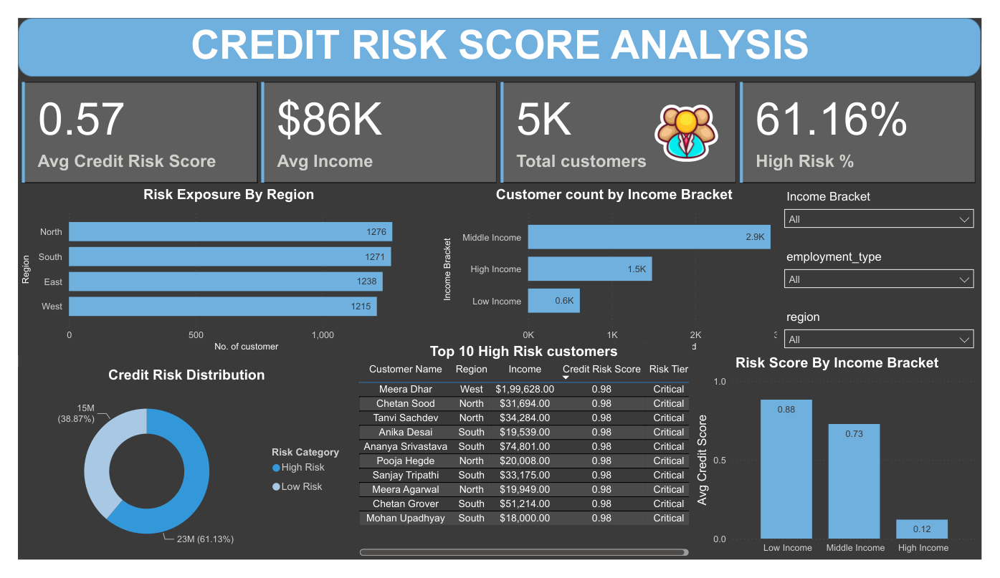
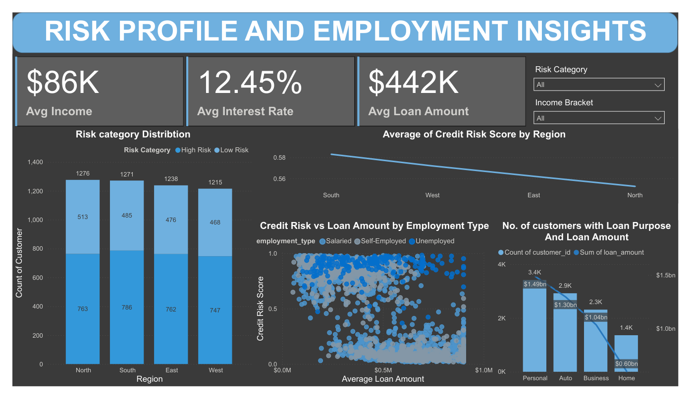
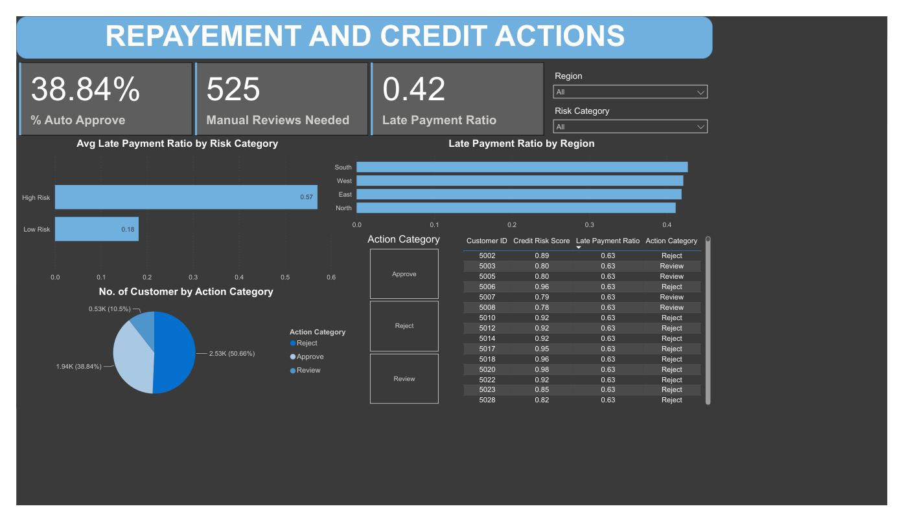

# Credit Risk Scoring System

A learning project that combines customer, loan, and repayment data to explore repayment risk with SQL, Python machine learning, and Power BI.

The workflow builds customer-level repayment features, labels customers by late-payment behavior, compares classification models, stores prediction scores in MySQL, and presents portfolio insights in a Power BI report.

> **Important:** The current 5,000-customer experiment uses synthetic data. Repayment outcomes were deliberately generated with a relationship to income and employment, plus random variation. The reported scores demonstrate the workflow and do not establish performance on real borrowers or support real credit decisions.

## Project files

| File or folder | Description |
| --- | --- |
| `Dataset/customers.csv`, `loans.csv`, `repayments.csv` | Original CSV data |
| `Dataset/synthetic_customers.csv`, `synthetic_loans.csv`, `synthetic_repayments.csv` | Synthetic data used for the current model results |
| `project1.sql` | MySQL tables, customer feature view, and credit score table |
| `import_synthetic_data.py` | Batch importer for synthetic CSVs |
| `credit_risk_score.ipynb` | Feature preparation, model training/evaluation, scoring, and SQL export |
| `credit_score_project.pbix` | Power BI report |
| `credit_score_project.pdf` | Static export of the report |
| `metrics_output/model_comparison.png` | Model metric comparison chart |
| `assets/dashboard-page-1.png` to `dashboard-page-3.png` | Screenshots rendered from the PDF report |

## Data and target definition

The relational data includes:

- **Customers:** ID, name, age, income, employment type, and region.
- **Loans:** ID, customer ID, loan amount, interest rate, purpose, tenure, and start date.
- **Repayments:** ID, loan ID, repayment date, amount paid, and due date.

The SQL view `customer_features` aggregates loan and repayment information by customer. The notebook defines its binary target as:

```text
High risk (1): late_payment_ratio > 0.40
Low risk (0):  late_payment_ratio <= 0.40
```

A repayment is late when its payment date is after its due date. The model excludes `customer_id` and `late_payment_ratio` from its inputs. Numeric features are imputed and scaled, categorical features are encoded, and SMOTE is applied to the training data after the train/test split.

The synthetic dataset contains **5,000 customers, 10,000 loans, and 80,000 repayment records**. In the recorded notebook run, 2,947 customers were high risk (58.94%) and 2,053 were low risk (41.06%). The generated scenario makes customers with income below 85,000 or unemployed status more likely to have late repayments, with 12% independent outcome variation.

## Classification results

The correct comparison for this README uses the 1,500-customer test set: 616 low-risk cases (class 0) and 884 high-risk cases (class 1), from a stratified 70/30 split. Precision, recall, and F1 are listed per class. Confusion matrices use `[[true negatives, false positives], [false negatives, true positives]]`.

| Model | Accuracy | Class 0 precision | Class 0 recall | Class 0 F1 | Class 1 precision | Class 1 recall | Class 1 F1 | Confusion matrix `[[TN, FP], [FN, TP]]` |
| --- | ---: | ---: | ---: | ---: | ---: | ---: | ---: | --- |
| Logistic Regression | 84.67% | 0.82 | 0.81 | 0.81 | 0.87 | 0.87 | 0.87 | `[[498, 118], [112, 772]]` |
| Random Forest | 87.20% | 0.87 | 0.81 | 0.84 | 0.88 | 0.91 | 0.89 | `[[501, 115], [77, 807]]` |
| XGBoost | 87.20% | 0.87 | 0.81 | 0.84 | 0.87 | 0.92 | 0.89 | `[[498, 118], [74, 810]]` |

Random Forest and XGBoost tie on accuracy in this test split. XGBoost has marginally higher high-risk recall (0.92 versus 0.91). Which model is preferable depends on the relative cost of missed high-risk cases and false alarms. These single-split results on generated data should not be treated as expected real-world performance.



## Power BI dashboard

The Power BI report is arranged across three pages:

1. **Credit Risk Score Analysis** — summary KPIs, risk distribution, regional exposure, income-bracket comparisons, customer filters, and a high-risk customer table.
2. **Risk Profile and Employment Insights** — risk counts by region, risk score versus loan amount by employment type, average income/interest/loan amount, and loan purpose analysis.
3. **Repayment and Credit Actions** — late-payment ratios by risk category and region, approve/review/reject action counts, and customer-level repayment details.

### Page 1 — Credit Risk Score Analysis



### Page 2 — Risk Profile and Employment Insights



### Page 3 — Repayment and Credit Actions



The PDF is a static export. Open `credit_score_project.pbix` in Power BI Desktop to interact with the report. Refreshing from MySQL requires the MySQL connector/provider and valid server, database, and credential settings.

## Setup and run

### 1. Install Python packages

```powershell
python -m pip install pandas numpy scikit-learn imbalanced-learn xgboost pymysql matplotlib
```

### 2. Create the MySQL schema

Run `project1.sql` using MySQL Workbench or another MySQL client. **The script starts by dropping and recreating the `credit_risk_project` database.** Back up any needed data before running it.

### 3. Import synthetic data

From the project directory, run:

```powershell
python import_synthetic_data.py
```

The importer prompts for the MySQL `root` password and inserts customers, loans, then repayments to satisfy foreign keys. To replace existing rows in the reserved synthetic ID ranges before importing again:

```powershell
python import_synthetic_data.py --replace-synthetic
```

The importer only loads the synthetic CSV files; it does not load the original CSVs.

### 4. Run the notebook

Open `credit_risk_score.ipynb`, enter the MySQL password when prompted, restart the kernel, and run the cells from top to bottom. The notebook trains and evaluates the classifiers, generates customer scores, and writes them into the MySQL `credit_scores` table.

### 5. Open Power BI

Open `credit_score_project.pbix` in Power BI Desktop. If refresh reports that `MySql.Data.MySqlClient` is unavailable, install the matching MySQL Connector/NET provider, then check the server, database, and saved credentials in **Data source settings**.

## Limitations and next steps

- Results depend on the data, split, random seeds, and package versions. Run the notebook from the beginning after changing the CSVs.
- The synthetic target pattern is intentionally learnable. High scores on this dataset do not show how a model will perform on real lending data.
- The target describes a late-payment-ratio threshold, not a verified default or charge-off outcome.
- For a real predictive use case, define a future outcome and observation window, use only information available before that window, evaluate on a later time period, and assess model performance and fairness before operational use.
